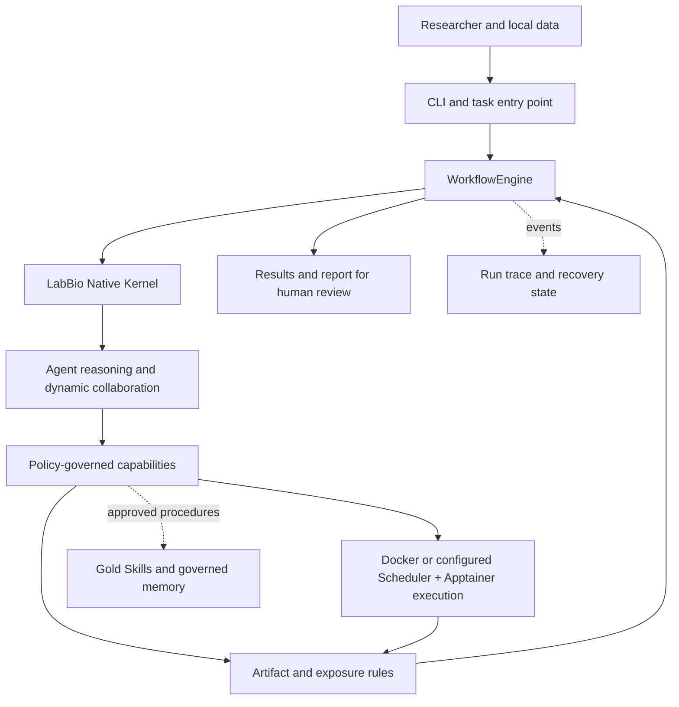

# LabBioAgentOS

**A research-stage framework for reproducible, governed bioinformatics agents.**

LabBioAgentOS connects natural-language scientific tasks to a structured
workflow, local analysis execution, traceable evidence, and user-visible
delivery. It keeps biological data, Agent reasoning, and system control within
explicit boundaries so that a run can be inspected, safely continued where
allowed, and reviewed by a human.

> **中文简介：** LabBioAgentOS 是一个本地优先、证据受控、可中断恢复的生信
> 多 Agent 运行系统。科学方法、参数、分析程序、解释和报告由运行中的 Agent
> 决定；平台负责工作流、权限、执行、Artifact、持久状态与审计边界。项目仍处于
> 研究开发阶段，生成的分析与科学结论需要研究人员核查。

The active source uses an independently designed and implemented **LabBio
Native Kernel**. It owns the runtime contracts directly and has no hidden
fallback to another Agent framework.

## Architecture



The default workflow is:

`INTAKE → UNDERSTAND → PLAN → PREFLIGHT → EXECUTE → VALIDATE → INTERPRET → REPORT → LEARN`

- `WorkflowEngine` is the sole authority for run state and stage transitions.
- The Native Kernel owns within-stage provider calls, strict tool transport,
  bounded Agent loops, Leader–Specialist collaboration, and typed finalization.
  It cannot directly mutate workflow state.
- The host binds identity, project, authorization, and execution policy. Model
  tool arguments cannot override those facts.
- Raw biological data stays in the local Artifact/execution plane. A remote
  model receives only policy-approved metadata, bounded previews, or derived
  results.
- Scientific strategy and specialist selection remain Agent-owned. The kernel
  has no keyword router or task-specific pipeline that substitutes for those
  decisions.

## Repository capabilities

- **Governed workflow:** typed stage proposals, explicit transitions, bounded
  recovery, user gates, and frozen runtime identity.
- **Native multi-Agent runtime:** exact provider binding, strict schemas,
  foreground tool dispatch, dynamic delegation, isolated child context,
  budgets, interruption, and typed outcomes.
- **Governed execution:** policy-controlled Docker or configured Scheduler +
  Apptainer runs with registered inputs, declared outputs, resource ceilings,
  and immutable receipts.
- **Artifact governance:** scoped identities, exposure decisions, bounded views,
  lineage, and content hashes.
- **Trace and continuation:** persisted run state, event records, safe status
  inspection, clarification, continuation, and revision.
- **Researcher oversight:** explicit decisions for governed actions and
  user-approved reusable Gold Skills.

These are framework capabilities, not a catalogue of validated biological
pipelines. Results depend on the configured model, data, tools, Agent decisions,
and independent human review.


## Install and verify

Use Python 3.11+ in an isolated environment rather than a system or base
environment.

```bash
python -m pip install -e '.[test]'
python -m pytest -q
labbio --help
```

A real task additionally requires:

1. an OpenAI-compatible Chat provider with credentials stored outside the
   repository;
2. an existing, deployment-approved Docker image, or a registered SIF for a
   configured cluster backend;
3. an external `runtime.toml` defining identity, allowed input roots, result
   root, resource limits, provider binding, and execution settings.

Start from `examples/local-runtime.toml`. The configuration references secret
environment variables; it must not contain API keys. See the
[local task guide](docs/LOCAL_TASK_ENTRYPOINT.md) for the local contract, or
[cluster deployment guide](docs/CLUSTER_DEPLOYMENT.md) for site prerequisites.

## Submit a task

```bash
labbio run \
  --data /allowed/path/input.h5ad \
  --format h5ad \
  --task "Summarize this dataset, save the results, and report limitations." \
  --preference "Keep the explanation concise and preserve uncertainty." \
  --output /configured/result/root/my-task
```

Read-only status and export operations do not call the model:

```bash
labbio status --run-dir /configured/result/root/my-task
labbio export --run-dir /configured/result/root/my-task
```

Run directories retain the request, frozen runtime identity, authoritative
SQLite state, trace, Artifacts, execution evidence, and delivery files. The
framework does not choose a final result by filename or modification time, and
it does not author scientific report text on the Agent's behalf.

For project-scoped use, history, clarification, continuation, and revision, see
the [local workspace guide](docs/LOCAL_WORKSPACES.md) and
[local task guide](docs/LOCAL_TASK_ENTRYPOINT.md).

## Documentation

## Citation and attribution

If LabBioAgentOS contributes to research methodology, analysis, publications,
or derivative software, please acknowledge the project and retain the original
copyright and license notices where required. Formal citation information will
be added when available.

Project repository: <https://github.com/YuchenWang-leslie/LabBioAgentOS>

## License

LabBioAgentOS is distributed under the [MIT License](LICENSE). Citation and
attribution requests express expectations for responsible scientific reuse and
do not add restrictions beyond that license.
